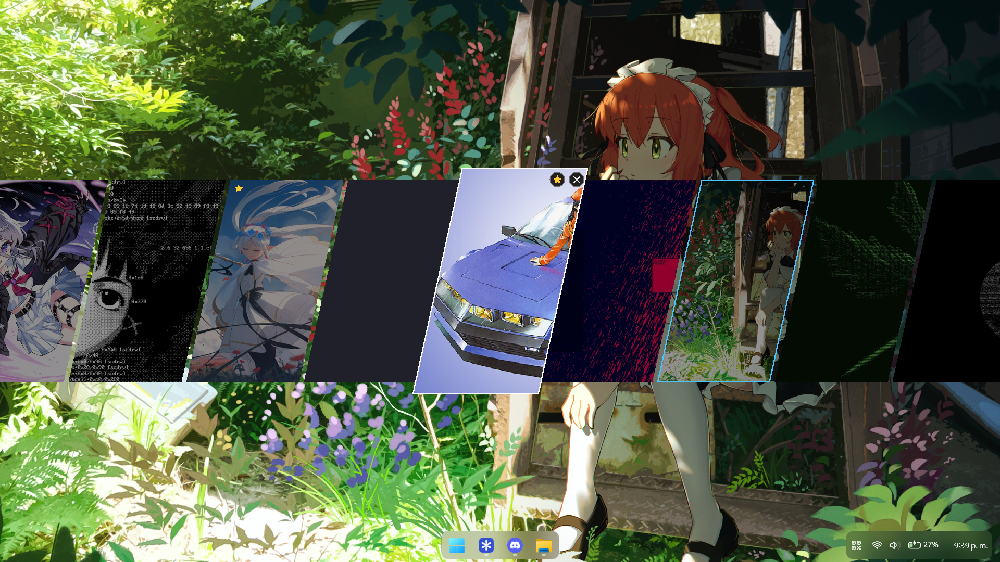
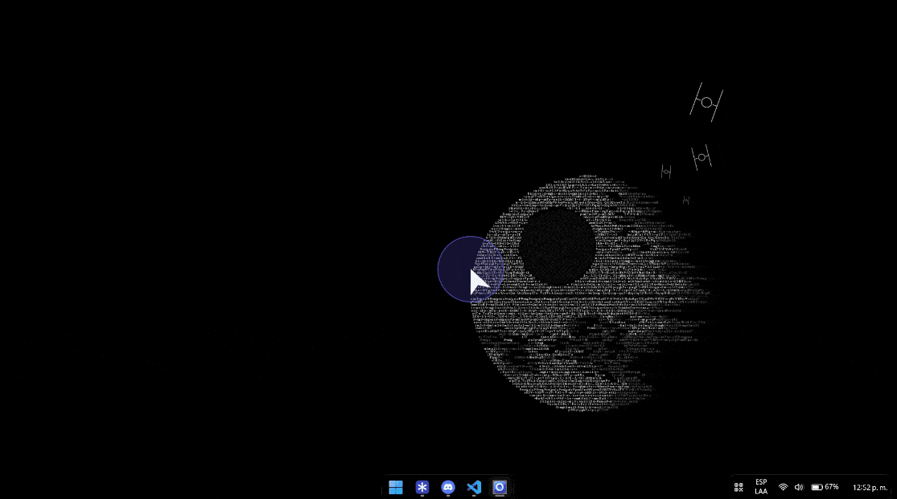

<div align="center">
    
    <h1>SWEPR</h1>
    <p>
        
        
        <a href="LICENSE"></a>
    </p>
    <p>A lightweight Windows desktop wallpaper selector.</p>
</div>

SWEPR runs in the system tray and lets you browse a folder of images, preview them in a thumbnail panel, and apply a wallpaper without opening a separate desktop app.

## Panel demos

### Pro mode




### Panel at the top



### Changing the panel position


## Features

- Scans a wallpaper folder for JPG, JPEG, JFIF, PNG, BMP, WebP, GIF, and TIFF images, with optional subfolder scanning. The gallery can be sorted by name or by date.
- Opens a thumbnail panel from screen edge sensors or a keyboard shortcut. Two panel modes are available: Low power, a thumbnail strip at the top, left, or right edge of the screen, and Pro, a carousel of slanted cards in the center.
- Highlights newly discovered images in green and places them at the beginning of the gallery. New images stay marked after restarting SWEPR until you apply them.
- Applies a selected wallpaper with the native Windows fade and lets you move through the collection with keyboard shortcuts. Navigation wraps around: after the last wallpaper comes the first one.
- Hovering a thumbnail or carousel card shows two buttons: a star to add it to or remove it from favorites, and an X to remove it from the gallery. Removing never deletes the file; removed images can be brought back from Settings > Removed images.
- Right-click a thumbnail (or press the Menu key) to set it as the wallpaper, set it on the current monitor only, use it as the lock screen image, add it to favorites (gold star), show it in Explorer, or remove it from the gallery.
- With several monitors, "Different wallpaper on each monitor" puts a different image on each screen for next, random, and automatic changes, and choosing an image in the panel changes only the monitor where the panel is open.
- Can change the wallpaper automatically at an interval, in order or at random, optionally only among favorites. Automatic changes are skipped while a full-screen game or presentation is running.
- Remembers the previous wallpapers so you can go back from the tray menu.
- Fit modes: Fill, Fit, Stretch, Center, Tile, and Span across all monitors.
- Two ways to change the wallpaper: through Windows (instantly or with the Windows fade), or the SWEPR canvas, which draws the wallpaper behind the desktop icons so changes start instantly with a transition: fade, slide, zoom in, wipe, circle, or a random one. The canvas uses the GPU only during transitions; it needs about 35 to 50 MB more memory than the Windows mode (more on integrated graphics, where video memory is shared), and that amount does not grow with the number of images.
- Keeps memory use low: thumbnails can be loaded all in advance or on demand, and Pro mode only loads the large cards that are on screen.
- Left-click the tray icon to open the panel. The tray menu offers next, random, and previous wallpaper, refreshing the gallery, opening the wallpaper folder, settings, and exit.
- Supports English and Spanish translations. The language can be selected in Settings; additional translation files can be added to the `languages` folder.
- Offers a dark Settings window for the wallpaper folder, subfolder scanning, Windows startup, the fit mode, gallery order, automatic changes, the wallpaper fade, panel mode, panel position, scrollbar visibility, thumbnail size and loading, and keyboard shortcuts. The window rescales when moved to a monitor with a different DPI.

## Installing and updating

Download `SWEPR-vX.Y.Z-setup.exe` from the releases and run it. SWEPR installs for the current user only (no administrator rights needed) in `%LOCALAPPDATA%\Programs\SWEPR` and adds a Start menu shortcut.

To update, just run the setup of the newer version. It closes SWEPR if it is running, replaces the installed version in the same folder, keeps your settings and favorites, and starts SWEPR again. For an update without any questions, run it with `/VERYSILENT`.

SWEPR can be uninstalled from Windows Settings > Apps. The uninstaller asks whether to also delete your settings.

## Using SWEPR

Start SWEPR and open its context menu from the system tray to access Settings and other actions. Choose the folder containing your wallpapers in Settings. The gallery refreshes when files in the folder change.

Default shortcuts:

| Shortcut | Action |
| --- | --- |
| `Ctrl` + `Alt` + `P` | Open the thumbnail panel |
| `Ctrl` + `Alt` + `Left` | Apply the previous wallpaper |
| `Ctrl` + `Alt` + `Right` | Apply the next wallpaper (a random one with `Random order`) |

Shortcuts can be changed in Settings: click a field and press the new key combination, or press Backspace to turn that shortcut off. Combinations without `Ctrl`, `Alt`, or `Win` get `Ctrl` + `Alt` added, and changes apply as soon as you save. Settings are stored at `%LOCALAPPDATA%\swepr\config.json`; they are written atomically, and if the file is ever damaged a copy is kept as `config.corrupt.json` before defaults are used. The log is `%LOCALAPPDATA%\swepr\log.txt` (the previous one is kept as `log.old.txt` when it grows past 5 MB). The language defaults to the Windows display language, or can be selected from the Settings window.

## Languages

Translation files are JSON files in `languages`, named with a language code such as `fr.json` or `fr-CA.json`. Use the keys in `en.json` and set `language_name` to the display name shown in the language selector. Place the file in the `languages` folder beside `swepr.exe`; restart SWEPR for it to appear in Settings. Missing translation keys are displayed in English.

## Project layout

```text
.
├── languages/              Translation files and language instructions
│   ├── en.json              English interface text
│   ├── es.json              Spanish interface text
│   └── README.md            Instructions for adding translations
├── resources/
│   ├── logo.png             Project logo shown in this README
│   ├── swepr.ico            Application icon for Windows
│   ├── swepr.rc             Windows icon resource definition (version info is added at build time)
│   └── demos/               README demo GIFs
│       ├── panel-top-demo.gif
│       ├── panel-position-demo.gif
│       ├── demo-pro.gif     Pro mode carousel demo
│       └── demo-pro.png     Pro mode carousel capture
├── src/
│   ├── app.rs               Application startup, events, and coordination
│   ├── canvas/
│   │   ├── mod.rs           SWEPR canvas: window behind the icons, Direct2D drawing, WIC decoding
│   │   └── layout.rs        Where each image is drawn for every fit mode
│   ├── config/
│   │   ├── mod.rs           Settings model and JSON persistence
│   │   ├── window.rs        Settings window
│   │   ├── theme.rs         Dark drawing of the Settings controls
│   │   ├── hotkey_field.rs  Field for capturing a keyboard shortcut
│   │   └── autostart.rs     Windows startup registration
│   ├── detector/
│   │   ├── mod.rs           Detector coordination
│   │   ├── zones.rs         Screen edge sensor zones
│   │   ├── mouse.rs         Mouse input detection
│   │   └── focus.rs         Desktop focus detection
│   ├── i18n.rs              Loading and selection of translations
│   ├── log.rs               Application logging
│   ├── panel/
│   │   ├── mod.rs           Thumbnail panel (Low power strip) and its interactions
│   │   └── carousel.rs      Pro mode carousel of slanted cards
│   ├── resources.rs         Embedded application icon loader
│   ├── scanner/mod.rs       Wallpaper folder scanning
│   ├── thumbs/mod.rs        Thumbnail creation and cache
│   ├── tray/mod.rs          System tray icon and context menu
│   ├── wallpaper/mod.rs     Windows wallpaper operations and fade
│   ├── watcher/mod.rs       Wallpaper folder change monitoring
│   ├── winutil/mod.rs       Shared Windows utility functions
│   └── main.rs              Program entry point and module declarations
├── .github/workflows/ci.yml Build, tests, Clippy, and translation key check
├── installer/
│   └── swepr.iss            Inno Setup script for the installer (install and update)
├── app.manifest             Windows application manifest
├── build.rs                 Embeds the manifest, icon, and version (taken from Cargo.toml)
├── Cargo.toml               Rust package metadata and dependencies
├── Cargo.lock               Locked Rust dependency versions
└── prepare-release.ps1      Builds the release installer (and optionally a portable ZIP)
```

## Build

SWEPR requires Windows, the Rust stable MSVC toolchain, and the Microsoft C++ build tools with a Windows SDK (for the linker).

From the repository directory, run:

```powershell
cargo build --release
```

The executable is created at `target\release\swepr.exe`. Keep the `languages` folder beside the executable so translations can be loaded when distributing or moving the application.

To create the installer, install [Inno Setup 6](https://jrsoftware.org/isinfo.php) (for example with `winget install JRSoftware.InnoSetup`) and run this from the repository root:

```powershell
.\prepare-release.ps1
```

The version comes from `Cargo.toml`, which is also embedded in the manifest, the file properties of `swepr.exe`, and the installer. For version 1.2.1 the installer is written to `releases\v1.2.1\SWEPR-v1.2.1-setup.exe`. Add `-Portable` to also create `SWEPR-v1.2.1-windows-x64.zip`. If Inno Setup is not in its default folder, set the `ISCC` environment variable to the path of `ISCC.exe`.

To release a new version, change `version` in `Cargo.toml`, run the script, and publish the new setup. Users update by running it over their existing installation. Never change the `AppId` in `installer\swepr.iss`: it is what lets a new setup find and replace the installed version.

Run the tests with `cargo test` and the linter with `cargo clippy --all-targets`.


## License

SWEPR is licensed under the GNU General Public License v3.0 only. See [LICENSE](LICENSE) for the full terms.
